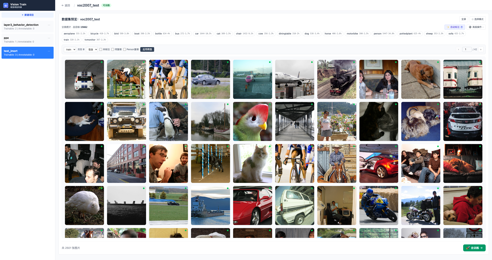
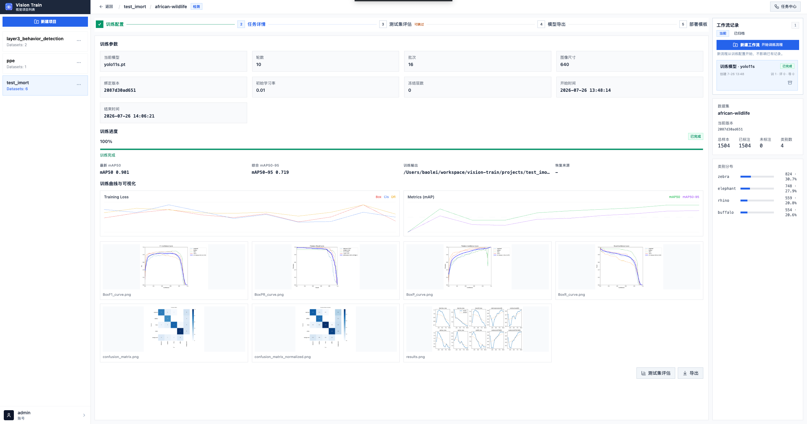

# Vision Train 文档

> 从数据准备到模型导出的一体化工作台

Vision Train 以「项目」为根上下文，把数据、训练流程和任务状态收口在同一套 Web UI 中。

  <h1>Vision Train</h1>
  
从数据准备到模型导出的一体化工作台

  

    <a class="primary" href="#/guide/quickstart">快速开始</a>
    <a href="#/sop/01-project">查看 SOP</a>
  

## 核心流程

训练工作流覆盖训练参数、任务详情、测试评估、模型导出、部署模板五个步骤。

## 当前能力

闭环：项目 → 数据集 → 标注 → 训练工作流 → 评估 / 导出 / 部署模板。

### 数据准备

| 模块 | 关键能力 |
| --- | --- |
| 项目管理 | 新建、编辑、删除、切换项目，按项目隔离数据与训练记录 |
| 数据集 | 导入现成数据、划分 train/val/test、下载或删除数据集 |
| 视频处理 | 上传视频、浏览器预览（不可解码编码自动转 H.264）、拖动裁剪新片段、抽帧并导入数据集 |
| 图片标注 | 框选目标、修改类别、删除错误标注、批量清理图片 |
| 智能辅助 | 模型预标注与以框找框产出待复核候选，在标注弹窗中审核，保存即写入正式标签，支持整批写入 |
| 数据整理 | 类别增删与重排、跨数据集复用类别表、图片去重、数据集合并、子集生成、跨 split 移动 |
| 走查列表 | 相似帧折叠、同类重复框筛选、浏览游标记忆 |
| 数据增强 | 针对弱类生成补强数据集，原数据集不变 |
| 数据集版本 | 发布 / 恢复 / 自动引导版本快照 |

### 模型训练与上线

| 模块 | 关键能力 |
| --- | --- |
| 模型训练 | 工作流管理多轮训练，支持 detect / classify / segment / pose |
| 效果检查 | 在 test split 上评估并查看指标 |
| 模型导出 | 导出 ONNX / OpenVINO / TensorRT 并下载产物 |
| 部署模板 | 基于 pt 或导出产物生成 FastAPI / Python SDK / 批处理模板包 |
| 远端训练 | 配置 GPU 服务器，SSH 预检后在远端执行训练并回传产物 |
| 工作流归档 | 归档 / 恢复训练工作流，历史任务与产物保留 |
| 任务中心 | 统一回看抽帧、标注、训练、评估、导出、部署模板任务 |

## 推荐阅读顺序

1. [快速开始](guide/quickstart)：把前后端跑起来
2. [SOP](sop/01-project)：走一遍完整闭环
3. [运行配置](deploy/config)：环境变量、路径与端口

## 一条完整使用路径

1. 登录并进入目标项目
2. 通过「导入数据集」或「视频抽帧导入」准备数据
3. 在数据集详情页完成标注、候选审核、数据整理与版本管理
4. 新建训练工作流并启动训练（本地或远端 GPU）
5. 训练完成后查看 test 评估结果
6. 导出模型，或生成 FastAPI / Python SDK / 批处理部署模板
7. 迭代轮换时归档当前工作流，需要时恢复
8. 在任务中心回看所有后台任务的状态与错误
