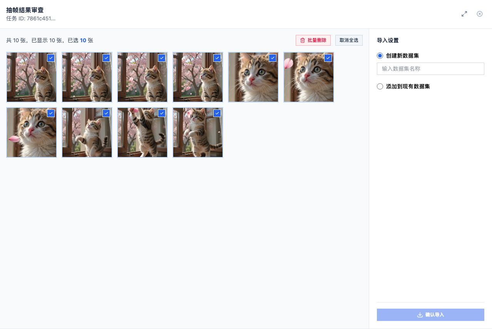

# SOP-2 视频抽帧

> 把视频沉淀成可训练的图片素材，并通过任务中心跟踪全过程。

## 2.1 目标

- 抽帧的输入、输出与适用场景
- 浏览器预览与区间裁剪如何减少无用帧
- 抽帧策略与产物的关系
- 任务中心回看方式



## 2.2 前置条件

- 已进入目标项目（参见 [SOP-1 项目管理](01-project.md)）。
- 已按快速开始装好后端依赖（`pip install -r requirements.txt`）：抽帧与转码用的 `ffmpeg` 由 `imageio-ffmpeg` 随依赖提供，无需宿主机单独安装。
- 决定抽帧结果要导入到哪个数据集；没有目标数据集也可以在抽帧完成后直接生成新数据集。

## 2.3 业务动作

### 上传视频

把视频原文件写入 `projects/<project>/videos/`。常见视频容器（mp4 / mov / avi / mkv / webm）均受支持。

### 预览播放

点视频封面进入播放器。浏览器能直接解码的编码（H.264 / VP8 / VP9）原样播放；不能解码的编码（如监控常见的 H.265）需先生成 H.264 预览副本，副本落在 `videos/.previews/`，**原视频不被改写**。

预览生成是后台任务：视频列表与播放器都显示进度，可取消、失败后可重新生成；已生成的副本会被复用，不重复转码。

### 裁剪片段

在播放器进度条上拖动起点与终点滑块选定保留区间，点「裁剪为新片段」生成一段 H.264 新视频，落在 `videos/<原名片段>_clip_<起>-<止>s.mp4`，**原视频不被改写**。

新片段与上传的视频一样出现在视频列表里，可直接对它发起抽帧。长监控视频先裁掉无人时段，再抽帧，能省掉大量无用帧与审查成本。

### 发起抽帧

针对一段视频发起抽帧任务，结果暂存于 `projects/<project>/temp_tasks/<task_id>/`。**未导入数据集之前，这些图片不会进入 `training/`**，抽错可直接重来。

### 抽帧策略

| 策略 | 语义 |
| --- | --- |
| 按时间间隔抽帧 | 每隔一段时间抽一张 |
| 按目标张数抽帧 | 自动估算采样间隔，目标张数优先 |

短试抽设稀一点避免相似帧；长视频先保守抽一轮控制审查成本。

### 审查与筛选

候选帧只在任务结果区临时存在，优先清理模糊帧、近似重复帧、无目标帧。

### 导入数据集

把保留的图片落地到 `projects/<project>/training/<dataset_name>/` 下，目录结构遵循标准 YOLO 布局，并补齐 `dataset.yaml`。导入到现有数据集时图片会写入对应 split。新导入的图片默认无人工标签，需要继续走 [SOP-3 数据标注](03-annotation.md)。

> 系统会为数据集写入首个 `current_version_id` 快照（参见 §2.6）。

## 2.4 任务状态与回看

### 任务状态

`pending`（等待调度）、`running`（抽帧中）、`completed`（可审查）、`failed`（附错误信息）、`stopped`（被主动停止）。

### 任务中心回看

任务中心统一回看跨任务记录，只读不写盘，覆盖抽帧 / 视频转码 / 标注 / 训练 / 评估 / 导出 / 部署模板。

### 删除任务的影响

如果任务尚未导入数据集，临时抽帧结果会一起清理；如果已经导入数据集，仅清理临时结果，已导入的图片不会被回删。

## 2.5 数据落点总览

```text
projects/<project>/
├── videos/                          # 视频原文件与裁剪出的新片段
│   └── .previews/                   # H.264 预览副本
├── temp_tasks/<task_id>/            # 抽帧任务临时结果
└── training/<dataset_name>/         # 导入后的目标数据集
```

## 2.6 与数据集版本的联动

- 数据集首次接收导入内容时，系统会写入第一个 `current_version_id` 快照。
- 后续导入新内容会沿用同一数据集，不再自动发布新版本；如需把变更沉淀成历史快照，使用 SOP-3 描述的发布版本能力。

## 2.7 失败排查

| 现象 | 排查方向 |
| --- | --- |
| 上传后无视频 | 确认上传格式受支持，文件未损坏 |
| 视频无法播放 | 该编码浏览器不能解码，在播放器里生成 H.264 预览副本 |
| 预览生成失败 | 看任务错误信息；确认已 `pip install -r requirements.txt`（`ffmpeg` 由 `imageio-ffmpeg` 提供） |
| 抽帧启动即失败 | 确认已 `pip install -r requirements.txt`（`ffmpeg` 由 `imageio-ffmpeg` 提供） |
| 抽帧结果很少 | 策略偏稀，调整间隔或目标张数 |
| 抽帧大量灰帧 / 无用帧 | 源视频关键帧损坏或含长时间空场景，先裁剪出有效片段再抽帧 |
| 导入后无法训练 | 数据集只有图片，需要继续走 SOP-3 标注 |

## 2.8 相关 SOP

- [SOP-3 数据标注](03-annotation.md)
- [SOP-7 模型训练](07-train.md)