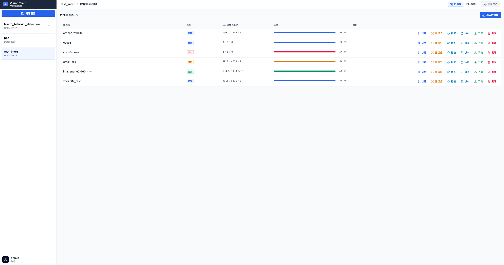

# SOP-3 数据标注

> 在数据集中导入图片后，完成标注、自动标注复核、批量整理与数据集版本管理。

## 3.1 目标

- 数据集导入与标注的完整业务闭环
- 待复核候选与正式标签的边界
- 批量整理（去重 / 合并 / 子集 / 弱类补偿 / 标签重排 / 类别删除）的语义
- 数据集版本（发布 / 恢复 / 引导）的语义边界



## 3.2 前置条件

- 已进入目标项目（参见 [SOP-1 项目管理](01-project.md)）。
- 数据集已存在，或通过 [SOP-2 视频抽帧](02-video-frame-extract.md) / 导入数据集动作创建。
- 决定当前数据集使用的视觉任务类型（`detect` / `classify` / `segment` / `pose`），参见 §3.6。

## 3.3 数据集导入

数据导入接受 YOLO 标准结构 zip 或目录：

```text
<dataset_name>/
├── dataset.yaml
├── train/{images,labels}
├── val/{images,labels}
└── test/{images,labels}
```

解压后的根目录落在 `projects/<project>/training/<dataset_name>/`，元数据落在 `<dataset>/.vision-train.meta.json`。

创建新数据集时，可以预先指定初始类别，类别会写入 `dataset.yaml` 的 `names` 字段。**初始类别在所有视觉任务类型（detect / classify / segment / pose）下均可用**，不限于分类任务。首次接收数据时系统会自动发布一个 `current_version_id` 快照。

## 3.4 业务动作

### 导入数据集

把压缩包解压到 `training/<dataset_name>/` 并补齐 `dataset.yaml`。同名数据集冲突时不能导入。导入后会自动发布首个数据集版本快照。

### 单图标注

标注器把每张图的标签写入 `<dataset>/<split>/labels/<image_stem>.txt`。**人工保存是唯一的落盘时机**，关闭或切图不会隐式保存。

键盘约定：

| 操作 | 语义 |
| --- | --- |
| 左右方向键 | 切换上一张 / 下一张 |
| `Delete` / `Backspace` | 删除选中框 |
| `Ctrl/Cmd + S` | 主动保存当前图片 |
| `Esc` | 关闭标注器 |### 待复核候选审核

模型预标注与相似探测的结果作为候选写入 `auto_labels/<split>/`，在标注弹窗中与人工标签同屏展示（虚线区分）。按「待复核」筛选逐张核对：删除误检、调整框、补充漏标，**保存即把该图候选并入正式标签**，不保存则仍是待复核。

### 批量操作

| 操作 | 语义 | 数据落点 |
| --- | --- | --- |
| 批量删除图片 | 删除图片及其标签 | `training/<dataset>/<split>/` |
| 图片去重 | 基于 MD5 删除完全重复图片，范围为当前 split 全量 | 同上 |
| 合并数据集 | 两个标准数据集复制合并为新数据集 | 新建 `training/<new_dataset_name>/` |
| 生成子集 | 从指定图片集合复制出新数据集 | 新建数据集目录 |
| 弱类补偿采样 | 生成针对弱类的补强数据集，原数据集不变 | 新建数据集目录 |
| 跨 split 移动 | 把图片连同人工标签与候选一起移动到目标 split | 源 / 目标 split 目录 |
| 添加类别 | 在 `dataset.yaml` 追加类别；分类数据集同时建类别目录 | `dataset.yaml` |
| 标签重排 | 修改类别顺序并同步重写所有标签 | `dataset.yaml` + 所有 `labels/*.txt` |
| 删除类别 | 移除类别及其标签行，标签全空的图片一并删除 | 同上；分类数据集还删空类别目录 |
| 清空待复核候选 | 清空筛选范围内图片的 `auto_labels` 候选 | 仅 `auto_labels/<split>/`，不动正式标签 |

> 添加 / 删除类别可在数据集详情的类别区直接操作，删除前要求二次确认。类别名仅允许字母、数字、`_`、`-`，最长 64 字符。
>
> 删除数据集 / 图片 / 类别均不可恢复，系统要求二次确认。

## 3.5 数据集版本管理

### 发布版本快照

数据集内容稳定后，把当前数据集固化成一份不可变快照，写入 `projects/<project>/training/.dataset-store/<dataset_id>/versions/<version_id>/`，并更新 `<dataset>/.vision-train.meta.json` 中的 `current_version_id`。这是后续"恢复"语义的前置步骤。

### 恢复历史版本

把快照内容覆盖当前数据集工作目录，并生成一条新的"恢复"版本记录作为当前版本。恢复动作不会丢失历史版本，但会生成新版本指针，请把它当作一次显式迭代。

### 自动引导版本

首次访问一个没有 `current_version_id` 的旧数据集时，系统会自动发布一个 `bootstrap` 版本作为当前版本，避免出现"工作数据集没有版本指针"的不一致。

### 删除数据集的影响

硬删 `training/<dataset_name>/` 与 `training/.dataset-store/<dataset_id>/`，同时清理与该数据集相关的训练工作流与产物。同级的 DVC 指针文件（`<dataset_name>.dvc`）也会一并清除。

## 3.6 视觉任务类型与标注协议

| 任务类型 | 标签格式 | 标注器 |
| --- | --- | --- |
| `detect` | `<class_id> <x> <y> <w> <h>` | 矩形框 |
| `classify` | `<class_id>` | 整图分类 |
| `segment` | `<class_id> <x1> <y1> <x2> <y2> ...` | 多边形 |
| `pose` | `<class_id> <x> <y> <v> ...` | 关键点 |

`pose` 数据集要求每个目标实例给出一组关键点及其可见性，与传统检测共享目录结构。

## 3.7 参数 / 字段含义

| 字段 | 含义 | 备注 |
| --- | --- | --- |
| `split` | `train` / `val` / `test` | 标注与筛选按 split 隔离 |
| `dataset_id` | 数据集稳定标识 | 写入 `.vision-train.meta.json`，与目录名解耦 |
| `current_version_id` | 当前工作数据集绑定的版本 | 缺失时自动 bootstrap |
| `vision_task_type` | 数据集所属任务类型 | 决定支持的标注器与训练模式 |
| `names` | 类别 ID → 类别名映射 | 写入 `dataset.yaml`；所有任务类型共享此字段 |
| `tags` | 数据集标签 | 写入 `dataset.yaml`，仅作展示与检索 |

## 3.8 失败排查

| 现象 | 排查方向 |
| --- | --- |
| 标注保存失败 | 检查标签文件是否被外部占用、目录是否可写 |
| 自动标注候选不可见 | 检查 `auto_labels/<split>/` 是否存在或已被清空 |
| 改类别顺序后旧标注错位 | 确认走的是系统的标签重排能力，而不是手工编辑 |
| 数据集版本快照异常 | 检查 `training/.dataset-store/<dataset_id>/` 是否可写 |
| 批量删除后无法恢复 | 默认无法恢复；删除前应自行备份 |

## 3.9 相关 SOP

- [SOP-2 视频抽帧](02-video-frame-extract.md)
- [SOP-4 自动标注](04-auto-annotation.md)
- [SOP-5 弱类补偿采样](05-class-rebalance.md)
- [SOP-6 类别顺序调整](06-class-reorder.md)
- [SOP-7 模型训练](07-train.md)